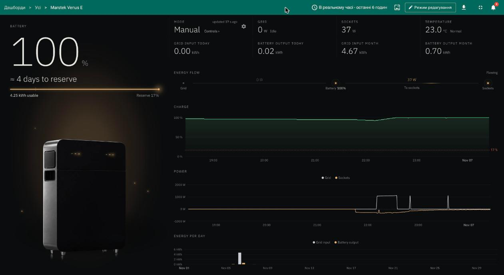

# Marstek Venus E on ThingsBoard

Monitor and control a Marstek Venus E home battery from ThingsBoard. A small bridge on your home network reads the battery over its local Open API and sends everything to ThingsBoard over MQTT, where a ready-made dashboard shows charge, power flows, energy per day, outages, and lets you set the mode, the schedule and the charge power of the battery.



## What you get

- **Battery card**: charge, usable energy, backup reserve, and an estimate of the time left to the reserve, or to full while charging.
- **Status cards** for mode, grid power, backup sockets, temperature, and grid input and battery output for today and this month. Click any card for its trend.
- **Energy flow** diagram and charts for charge, power and energy per calendar day.
- **Power outage** shown from the battery's own data: the Grid card reads *Off* and the battery card says since when it has been discharging.
- **Battery control** page: Auto, AI, Manual, Passive and UPS modes, a weekly schedule of up to 10 windows, and charge or discharge at a chosen power for a chosen time.
- **Battery settings**: charge power, depth of discharge, LED and Bluetooth advertising.
- **High battery temperature** alarm in the device profile.
- Light and dark themes with automatic switching at sunrise and sunset.
- Discharging into the grid is off by default and enforced by the bridge, not only hidden in the UI.

## How it works

```
Marstek Venus E  ──UDP, Local API──▶  bridge (Python, on your LAN)  ──MQTT──▶  ThingsBoard  ──▶  dashboard
                 ◀──ES.SetMode etc.──                                 ◀──RPC──
```

The bridge polls the battery once a minute (the battery drops UDP packets when asked more often), converts the readings, keeps daily and monthly counters, works out whether the mains are present, and sends the result as telemetry with QoS 1. Commands from the dashboard arrive as ThingsBoard RPC and are written to the battery one call at a time. What the battery cannot report back (its schedule, depth of discharge, LED and Bluetooth state) the bridge remembers in a state file and as device attributes, so a redeploy restores it.

ThingsBoard can be [ThingsBoard Cloud](https://thingsboard.cloud) or your own installation, 4.4 or newer.

## Quick start with ThingsBoard IoT Hub

1. Install the **Marstek Venus E home battery** solution template from IoT Hub. It creates the device profile, a demo device with simulated data and the dashboard.
2. In the Marstek app, open your Venus E and turn on **Open API**. Note the battery's IP address and UDP port (30000 by default). Give the battery a static IP address.
3. In ThingsBoard, open the **Marstek Venus E** device and copy its access token.
4. Run the bridge on a machine in the same network as the battery (a Raspberry Pi, a NAS, any always-on PC):

```bash
git clone https://github.com/pon0marev/marstek-venus-e-thingsboard.git
cd marstek-venus-e-thingsboard
cat > bridge.env <<'ENV'
MARSTEK_HOST=192.168.1.50
TB_URL=https://thingsboard.cloud
TB_ACCESS_TOKEN=YOUR_DEVICE_ACCESS_TOKEN
TZ=Europe/Kyiv
ENV
docker build -t marstek-bridge bridge
docker run -d --name marstek-bridge --restart unless-stopped --env-file bridge.env -v marstek-bridge-data:/data marstek-bridge
```

Without Docker, the bridge runs on Python 3.9 or newer: `pip install "paho-mqtt>=2,<3" tzdata`, then `python3 bridge/bridge.py` with the same variables in the environment and `STATE_FILE` pointing at a writable file.

`docker logs marstek-bridge` shows `mqtt connected` and then one `sent {...}` line per minute. The dashboard cards turn grey when nothing has arrived for 3 minutes.

## Quick start without IoT Hub

`docker-compose.yml` in this repository starts ThingsBoard, PostgreSQL and the bridge together. In that mode the bridge logs in as a tenant, creates the device and the dashboard itself, and uploads the widgets.

```bash
cp .env.example .env            # set MARSTEK_HOST
docker compose --profile init up thingsboard-init   # first time only: installs ThingsBoard
docker compose up -d
```

ThingsBoard is then at http://localhost:8081 (`tenant@thingsboard.org` / `tenant`). The same works against an existing ThingsBoard by setting `TB_URL` and either `TB_USER` and `TB_PASSWORD` or `TB_API_KEY`; the bridge updates the dashboard in place when a new version is deployed.

## Bridge settings

| Variable | Default | Meaning |
|---|---|---|
| `MARSTEK_HOST` | required | IP address of the battery |
| `MARSTEK_PORT` | `30000` | UDP port set in the Marstek app |
| `POLL_INTERVAL` | `60` | seconds between polls |
| `TZ` | `UTC` | time zone for the daily and monthly counters |
| `TB_URL` | required | ThingsBoard address, e.g. `https://thingsboard.cloud` |
| `TB_ACCESS_TOKEN` | | device access token; the bridge then only sends data and answers commands |
| `TB_USER`, `TB_PASSWORD` or `TB_API_KEY` | | tenant credentials instead of a token: the bridge creates the device, the widgets and the dashboard |
| `TB_DEVICE_NAME` | `Marstek Venus E` | device name used with tenant credentials |
| `TB_MQTT_HOST`, `TB_MQTT_PORT`, `TB_MQTT_TLS` | from `TB_URL` | MQTT endpoint: 8883 with TLS for https, 1883 without TLS for http |
| `ALLOW_DISCHARGE` | `false` | start with discharging into the grid allowed; the dashboard switch overrides it |
| `STATE_FILE` | `/data/state.json` | where counters, schedule and settings are kept |

Readings taken while ThingsBoard is unreachable wait in the bridge's memory (up to 2000, about 33 hours) and are delivered with their own timestamps once the link is back.

## Telemetry

Keys from the battery keep their API name with the method prefix: `es_bat_soc`, `es_ongrid_power` (negative while charging), `es_offgrid_power`, `es_mode`, `es_total_grid_input_energy`, `bat_bat_temp`, `bat_bat_capacity`, `bat_rated_capacity`, `bat_charg_flag`, `bat_dischrg_flag`, `wifi_rssi`. The bridge adds `grid_input_day`, `grid_input_month`, `battery_output_day`, `battery_output_month`, `battery_output_total` (Wh), and `mains` (1 or 0) with `mains_since` (timestamp of the last change).

Device attributes: `manual_windows`, `allow_discharge`, `dod`, `led`, `ble_adv`, and the device info (`device_model`, `firmware`, `ip`, `wifi_name`).

RPC methods answered by the bridge: `getState`, `refresh`, `setMode`, `setPassive`, `setManual`, `setManualAll`, `setChargePower`, `setAllowDischarge`, `setDod`, `setLed`, `setBle`. The dashboard uses them all; `bridge/bridge.py` has the parameters.

## Known limits

- The battery cannot report its schedule, depth of discharge, LED or Bluetooth state, so the dashboard shows what was last set or recorded from it. A schedule made in the Marstek app is not visible and is replaced by the first schedule applied from the dashboard.
- The battery has no grid-presence flag. The bridge infers an outage from stored energy falling with 0 W on the grid port, which takes up to about 10 minutes when nothing is plugged in; the return of the grid is seen as soon as charging starts.
- Marstek documents the depth of discharge, LED and Bluetooth commands for firmware 150 or newer; a Venus E 3.0 on firmware 148 accepted them.
- Marstek warns that enabling the Local API may disable some built-in features to avoid command conflicts, and recommends a UDP port between 49152 and 65535.
- Tested with a Venus E 3.0 (5.12 kWh) against ThingsBoard Cloud and ThingsBoard 4.4.0.2.

## Repository layout

- `bridge/` — the bridge (`bridge.py`), the dashboard generator (`dashboard.py`) and the custom widgets (`widgets/`)
- `solution-template/` — the IoT Hub package: description, instructions, build script and the generated package
- `docker-compose.yml` — local ThingsBoard with the bridge, for development and for running without IoT Hub
